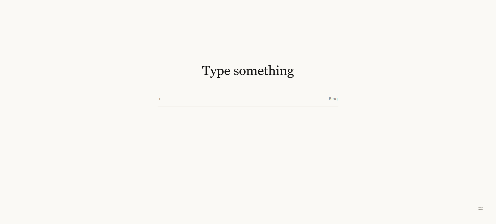
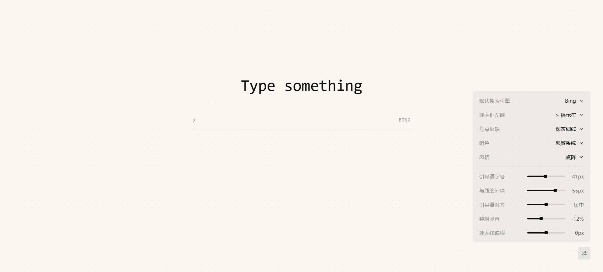

# LineTab

一条底线的新标签页。零网络请求、零依赖、零构建。





去掉时钟、宫格和新闻流，只留一句引导语和一个搜索框。三套风格（纸白 / 点阵 / 暖陶），亮暗跟随系统。

## 特点

- 搜索走你自己的引擎：Google、Bing，或在设置里填一个带 `%s` 的自定义地址
- 设置存入 `chrome.storage.sync`，登录同一账号的其他设备自动同步
- 只申请 `storage` 一项权限，页面本身不发任何网络请求
- 纯静态文件，没有构建步骤；改完源码刷新即可看到效果

## 安装

尚未上架商店。本地安装：

1. 从 [Releases](https://github.com/vv721/LineTab/releases) 下载 zip 并解压
2. 打开 `chrome://extensions`，开启「开发者模式」
3. 点「加载已解压的扩展程序」，选择解压出的 `LineTab` 目录

## 开发

```bash
npm ci
npm run check      # 结构、令牌与风格约束
npm run test:all   # 视觉基准 + 扩展行为
npm run pack       # 生成 release/LineTab-<version>.zip
```

## 目录

| 路径 | 内容 |
| --- | --- |
| `LineTab/` | 扩展本体，11 个运行文件 |
| `design/` | 看稿页、风格方案与探索留档 |
| `scripts/` | 校验、测试、打包脚本 |
| `docs/` | 设计记录、交接摘要，以及 README 用的截图 |

## 隐私

不收集、不上传任何数据；搜索词由你的浏览器直接提交给所选搜索引擎，不经过开发者。详见 [PRIVACY.md](PRIVACY.md)。

## License

MIT © 2026 vv721。设计过程与取舍见 [docs/设计记录.md](docs/设计记录.md)。
